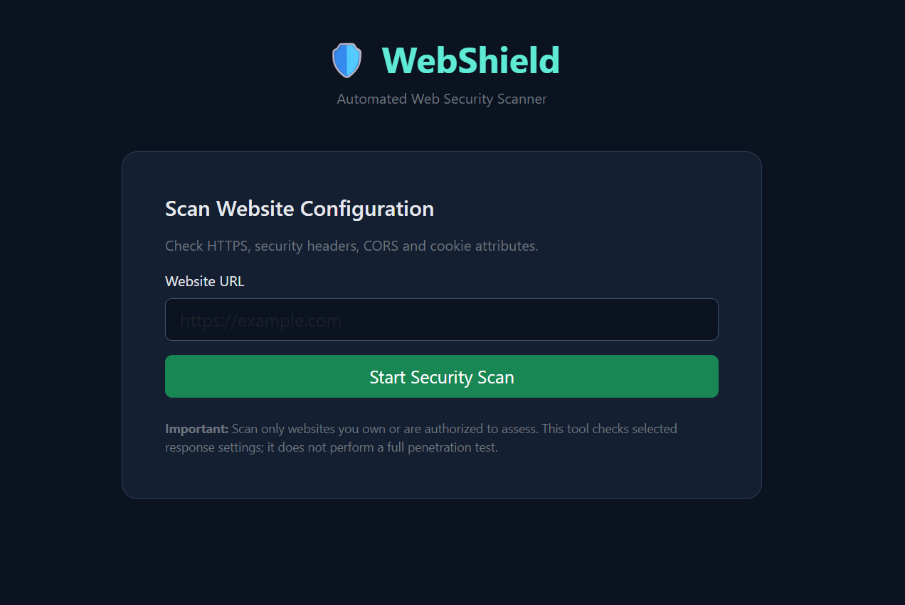
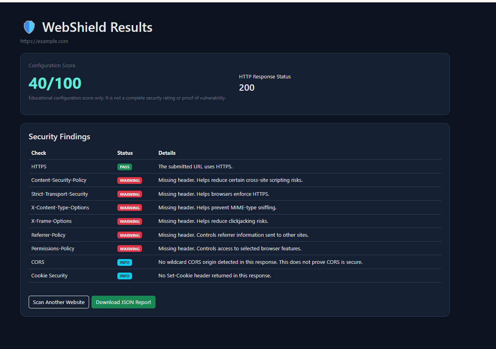

# 🛡️ WebShield – Automated Web Security Scanner

**A Python Flask-based tool for identifying basic web security misconfigurations.**

WebShield is an educational web security scanning application that analyzes a website's HTTP response to identify common security configuration issues. It checks HTTPS usage, security headers, cookie protection settings, and Cross-Origin Resource Sharing (CORS) configurations. The application generates an educational security score and a report of findings to help users understand potential improvements.

## 📌 Table of Contents

- [Overview](#overview)
- [Features](#features)
- [Technologies Used](#technologies-used)
- [Project Structure](#project-structure)
- [Installation](#installation)
- [How to Run](#how-to-run)
- [How It Works](#how-it-works)
- [Security Checks](#security-checks)
- [Screenshots](#screenshots)
- [Limitations](#limitations)
- [Future Enhancements](#future-enhancements)
- [Disclaimer](#disclaimer)
- [Author](#author)

## 📖 Overview

Website security is essential for protecting users, data, and online services. Misconfigured security headers, insecure cookies, and incorrect CORS settings can expose websites to potential risks.

WebShield automates basic security checks by sending HTTP requests, examining website responses, and presenting findings in an easy-to-understand format.

This project demonstrates Python programming, web development using Flask, HTTP response analysis, and basic automated security testing.

## ✨ Features

- **HTTPS Detection:** Checks whether the submitted URL uses HTTPS.
- **Security Header Analysis:** Identifies missing recommended HTTP security headers.
- **Cookie Security Analysis:** Checks attributes such as `Secure`, `HttpOnly`, and `SameSite`.
- **CORS Configuration Check:** Identifies potentially unsafe wildcard-origin and credential combinations.
- **HTTP Status Detection:** Displays the HTTP status code returned by the website.
- **Redirect Detection:** Identifies redirects and reports their destination.
- **Security Score:** Calculates an educational score based on selected checks.
- **Detailed Findings:** Presents detected issues and recommendations.
- **JSON Report Download:** Allows scan results to be downloaded as a JSON report.
- **URL Validation:** Validates URLs and blocks certain private or non-public destinations to help reduce SSRF risks.

## 🛠️ Technologies Used

| Technology | Purpose |
|---|---|
| Python | Core programming and scanning logic |
| Flask | Web application framework |
| Requests | Sending HTTP requests |
| HTML5 | Building the user interface |
| CSS3 | Styling the web interface |
| JSON | Exporting scan reports |
| Git and GitHub | Version control and project hosting |

## 📂 Project Structure

automated-web-scanner/
├── app.py
├── HaseebaAli_AutomatedWebScanner.py
├── requirements.txt
├── README.md
├── .gitignore
├── images/
│   ├── webshield-home.png
│   └── webshield-results.png
└── templates/
    ├── index.html
    └── result.html

**Note:** The standalone `HaseebaAli_AutomatedWebScanner.py` script includes its HTML templates within the Python file. Use the entry point that matches your project version.

## ⚙️ Installation

### Prerequisites

- Python 3.10 or later
- pip package manager
- Visual Studio Code or another code editor
- Git (optional)

### Step 1: Clone the repository

git clone https://github.com/haseeba2207-debug/webshield-automated-web-scanner.git

### Step 2: Open the project folder

cd webshield-automated-web-scanner

### Step 3: Create a virtual environment

python -m venv venv

Activate it using Windows Command Prompt:

venv\Scripts\activate.bat

Or Windows PowerShell:

.\venv\Scripts\Activate.ps1

### Step 4: Install dependencies

python -m pip install -r requirements.txt

## ▶️ How to Run

For the version using `app.py` and the `templates` folder:

python app.py

For the standalone version:

python HaseebaAli_AutomatedWebScanner.py

Open your browser and visit:

**http://127.0.0.1:5000**

Enter a website you own or have permission to test, start the scan, and review the results.

## 🔄 How It Works

1. **URL Input:** The user enters a website URL.
2. **URL Validation:** The application validates the URL and checks whether the destination is permitted.
3. **HTTP Request:** Python Requests retrieves the website's HTTP response.
4. **Security Analysis:** The scanner examines headers, cookies, HTTPS usage, and CORS configuration.
5. **Score Calculation:** A basic score is calculated from selected security checks.
6. **Results Display:** Flask presents the score, HTTP status, and detected findings.
7. **Report Export:** The user can download the scan report in JSON format.

## 🔍 Security Checks

| Check | Purpose |
|---|---|
| HTTPS | Checks whether the submitted URL uses HTTPS |
| Content-Security-Policy | Helps control permitted content sources |
| Strict-Transport-Security | Helps browsers enforce HTTPS |
| X-Content-Type-Options | Helps prevent MIME-type sniffing |
| X-Frame-Options | Helps mitigate clickjacking |
| Referrer-Policy | Controls referrer information sent by browsers |
| Permissions-Policy | Controls access to selected browser features |
| Cookie Attributes | Checks `Secure`, `HttpOnly`, and `SameSite` |
| CORS | Identifies potentially unsafe wildcard-origin and credential combinations |
| HTTP Status | Records the response status code |
| Redirects | Reports redirect information when available |

## 📸 Screenshots

### 1. WebShield Home Page

### 2. Website Scan Results

## ⚠️ Limitations

- The scanner checks a limited set of HTTP-level security configurations.
- Some websites may block automated requests or return connection errors.
- Results depend on the website's current response and configuration.
- A missing header does not always mean a website is vulnerable.
- The scanner does not perform comprehensive penetration testing, authentication testing, or source-code analysis.
- The score is a simplified educational indicator, not a formal security rating.

## 🚀 Future Enhancements

- Add more security checks and configurable scanning options.
- Improve report design and usability.
- Store scan history in a database.
- Generate downloadable PDF reports.
- Add severity levels and remediation guidance.
- Introduce automated tests and stronger SSRF protections.
- Support additional security analysis techniques.

## 🔐 Disclaimer

WebShield is developed for educational purposes and authorized security testing only. Scan only websites you own or have explicit permission to test. Do not use this application to conduct unauthorized security assessments.

This tool provides basic configuration checks and is not a substitute for a professional security audit or penetration test.

## 👩‍💻 Author

**Haseeba Feroz Ali**

MSc Blockchain Technology

GitHub: [haseeba2207-debug](https://github.com/haseeba2207-debug)

*WebShield — Identify basic web security misconfigurations and learn how to improve website security.*
